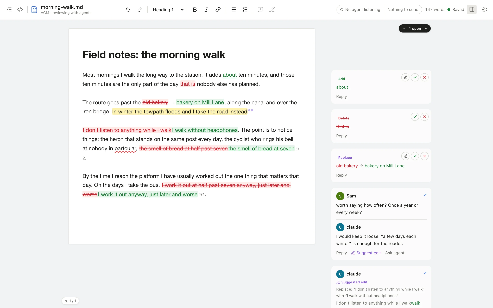

# ACM: Agent CriticMarkup

[](https://github.com/lucharo/acm/actions/workflows/ci.yml)

`acm` is a local editor where you and your coding agents review one Markdown document together.

- **Agents comment and suggest edits; you accept, reject or resolve them** in a rendered page with cards beside the prose.
- **The file is the API.** Everything lives in one [CriticMarkup](https://github.com/CriticMarkup/CriticMarkup-toolkit) `.md` file on disk. Claude Code, Codex or a shell script can read and write it with no integration, and the page updates within about a second.
- **Local only.** No account, no cloud, no database.
- **Works on your phone.** Open the same document on another device over [Tailscale](docs/getting-started.md#open-it-from-another-device); on a phone, the cards move into a bottom sheet.



## Try it

On macOS or Linux x64, with no Bun or Node needed:

```bash
curl -fsSL https://raw.githubusercontent.com/lucharo/acm/main/install.sh | sh
cd ~/writing        # any folder: acm works from anywhere
acm edit notes.md
```

The installer puts `acm` in `~/.local/bin` and the `acm-review` skill where Claude Code and Codex find it. Then ask your agent to review `notes.md`.

## Docs

Full documentation: https://acm.luischav.es

| You want to | Read |
| --- | --- |
| Install, open a document, run a first agent review | [Getting started](docs/getting-started.md) |
| Work through cards, suggestions and groups in the editor | [Reviewing](docs/reviewing.md) |
| Point an agent at a document | [Agents](docs/agents.md) |
| Drive ACM from the shell | [CLI reference](docs/cli.md) |
| Write the markup by hand | [CriticMarkup syntax](docs/syntax.md) |
| Get past an error message | [Troubleshooting](docs/troubleshooting.md) |
| Build, test or change ACM | [Maintainers](docs/maintainers.md) |

The site shows the real command output that GitHub shows only as `--8<--` include lines. Run `just docs` to read it locally.

## What ACM is not

One document per editor window: no workspace or file browser. No accounts, cloud or multiplayer cursors. Import from Google Docs is a one-shot conversion; ACM keeps no connection to Google.
