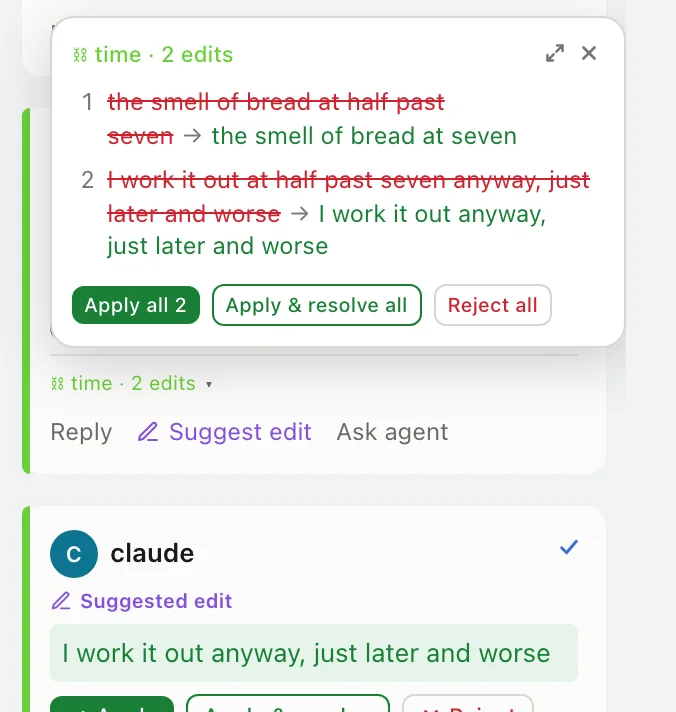

# Getting started

By the end of this page you have `acm` on your `PATH`, a document open in the editor, and an agent's comments and suggestions on it waiting for your decision.

## Before you start

| You need | Why |
| --- | --- |
| [Bun](https://bun.sh) 1.3.14 exactly | Setup checks the version pinned in `package.json` and stops on any other. With a different Bun, or none, run `npx --yes bun@1.3.14 run setup` instead. The installed `acm` needs no Bun to run. |
| Node 22.20 or newer | Setup installs the agent skill with `npx skills add`, which needs it. |
| A user-local bin directory on `PATH` | Setup installs the binary there, normally `~/.local/bin`. |
| Claude Code, Codex or another agent | Optional. Without one you can still edit and review by hand. |

## Install

From a clone of the repository:

```bash
bun run setup
```

Setup does four things, in order:

1. Checks the Bun and Node versions and installs the locked dependencies.
2. Builds one standalone `acm` executable with the editor embedded.
3. Installs it into a bin directory already on your `PATH` (normally `~/.local/bin`).
4. Installs the `acm-review` skill for Codex and Claude Code (`~/.agents/skills/` and `~/.claude/skills/`) through the standard `skills` CLI, then checks that `acm` and the skill are both found.

It ends with:

```text
✓ ACM setup complete: /Users/you/.local/bin/acm
```

To install into a different directory, set `ACM_INSTALL_DIR`:

```bash
ACM_INSTALL_DIR="$HOME/bin" bun run setup
```

## Open a document

```bash
acm edit notes.md
```

`acm` creates `notes.md` if it does not exist, starts a local server for that one file and opens it in your browser:

```text
--8<-- "edit.txt"
```

- Each `acm edit` serves exactly one document. Open a second document with a second `acm edit`; it takes the next free port.
- `acm edit` with no file opens a launcher with **New**, **Open** and **Recent Documents**.
- Run `acm` on its own for a short overview, `acm --help` for every command, and `acm <command> --help` for one.

Stop the editor with `Ctrl+C` in its terminal once the header shows **Saved**; ACM saves a moment after you stop typing.

## Run your first agent review

Setup installed the `acm-review` skill, so your agent already knows the markup and the `acm` commands. Leave the editor running, start your agent in a second terminal (any folder) and ask it in plain words:

```text
Review notes.md in ACM. Comment on anything unclear and suggest tighter wording.
```

The agent writes comments and suggestions into the file, through the running editor so nothing you are typing gets overwritten. They appear as cards beside the prose within about a second.

- An agent session started before setup needs a restart to see the skill.
- Claude Code asks before each `acm` command it runs. Choose "don't ask again" at the first prompt, or add `Bash(acm:*)` to `permissions.allow` in its settings.



Then decide on each card: **Accept** or **Reject** a suggestion, **Resolve** a thread you are done with, or reply. [Reviewing](reviewing.md) covers every card and shortcut.

## Open it from another device

ACM only answers on this machine unless you allow another host name. With Tailscale up, the Mac's Tailscale name is allowed by default; otherwise pass `--allow-host`. Start the editor as usual, then in a second terminal forward a port with Tailscale and open `https://<mac>.<tailnet>.ts.net:10464/` on the other device:

```bash
tailscale serve --bg --https=10464 http://127.0.0.1:12000
```

Use the port `acm edit` printed if it is not 12000. Open documents with `acm edit <file>` for this: the launcher stays local, because opening a document from it moves to a new port the forward does not follow.

## What ACM writes on disk

- **The document**: ACM writes it only when you or an agent edit. Opening a file does not rewrite it.
- **A `.acm/` folder beside it**: history, snapshots, provenance and the decision log. It carries its own `.gitignore`, so git ignores it.
- **`$XDG_CONFIG_HOME/acm/`** (default `~/.config/acm/`): settings, seen state, your personal dictionary and the list of running editors.

Changes saved to the document by another editor show up in ACM within about a second.

## Update

Pull the latest code and run setup again:

```bash
git pull
bun run setup
```

Setup replaces the installed binary and the skill in place. An editor that is already running keeps the old version until you stop it and run `acm edit` again.

If you edited the installed skill by hand, setup stops before changing anything. `bun run setup --force` first copies your edited skill to a timestamped folder under `~/.agents/skill-backups/`, then replaces it.

## Import a Google Doc

To review an existing Google Doc or Word file in ACM, convert it once:

```bash
acm import "https://docs.google.com/document/d/<id>/edit"
acm import review-draft.docx
acm import review-draft.docx review.md
```

The result keeps prose, headings, bullet lists, comments with their authors, and tracked insertions and deletions. A link only works for a Doc anyone with the link can view; for a private Doc, download it as `.docx` first. ACM keeps no connection to Google after the import. The output file is written directly and replaced if it exists, with no snapshot, so give it a new name.

---
<!-- doc-audit:last-reviewed -->
_Last reviewed: 2026-11-06 · commit `c0379f7` · verified against code._
