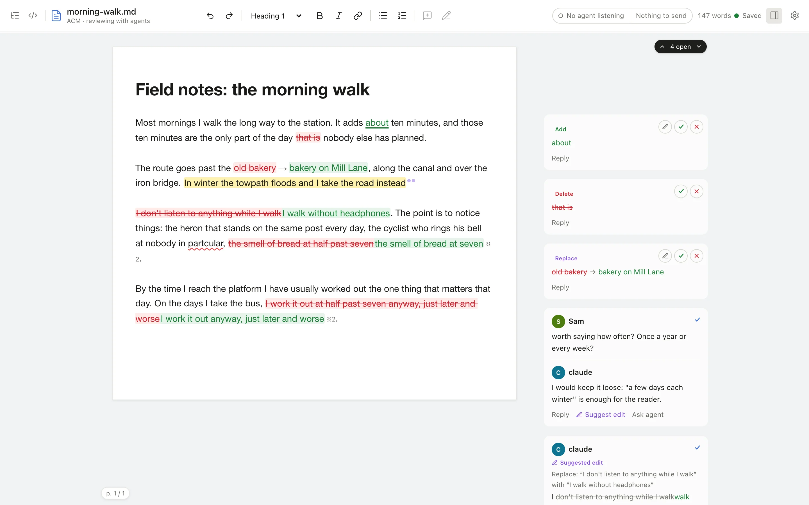

# ACM

`acm` is a local editor where you and your coding agents review one Markdown document together.

- **Agents comment and suggest edits; you accept, reject or resolve them** in a rendered page with cards beside the prose.
- **The file is the API.** Everything lives in one CriticMarkup `.md` file on disk. Claude Code, Codex or a shell script can read and write it with no integration, and the page updates within about a second.
- **Local only.** No account, no cloud, no database.



## Try it

On macOS or Linux x64, with no Bun or Node needed:

```bash
curl -fsSL https://raw.githubusercontent.com/lucharo/acm/main/install.sh | sh
cd ~/writing        # any folder: acm works from anywhere
acm edit notes.md
```

Then ask your agent to review `notes.md`. [Getting started](getting-started.md) walks through each step.

## Where next

| You want to | Read |
| --- | --- |
| Install, open a document, run a first agent review | [Getting started](getting-started.md) |
| Work through cards, suggestions and groups in the editor | [Reviewing](reviewing.md) |
| Point an agent at a document | [Agents](agents.md) |
| Drive ACM from the shell | [CLI reference](cli.md) |
| Write the markup by hand | [CriticMarkup syntax](syntax.md) |
| Get past an error message | [Troubleshooting](troubleshooting.md) |
| Build, test or change ACM | [Maintainers](maintainers.md) |
