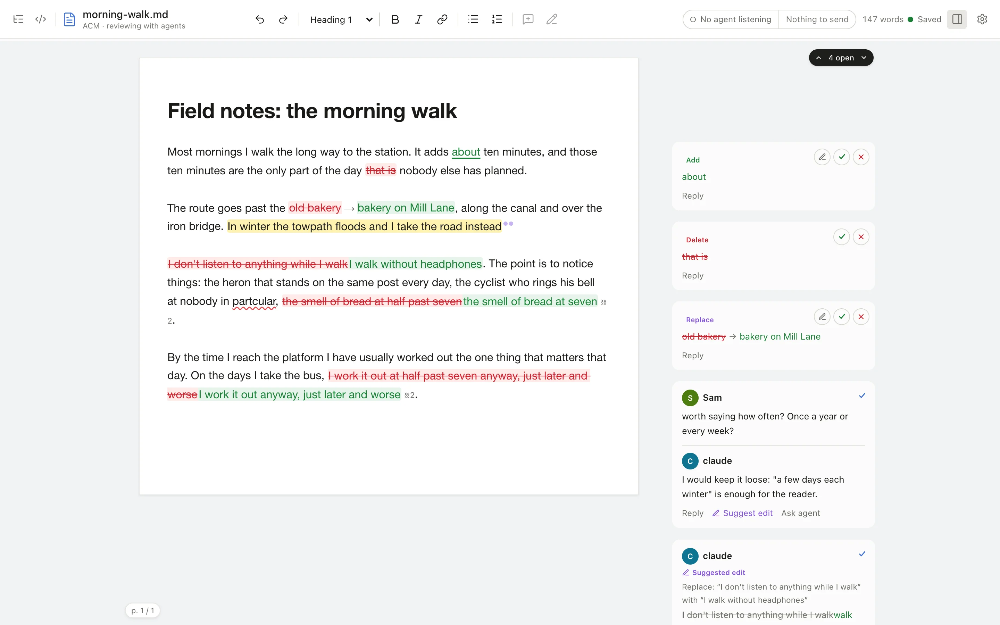
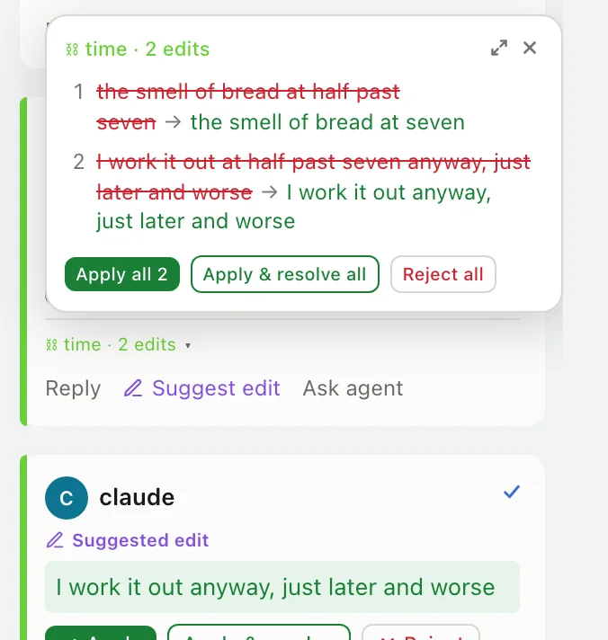
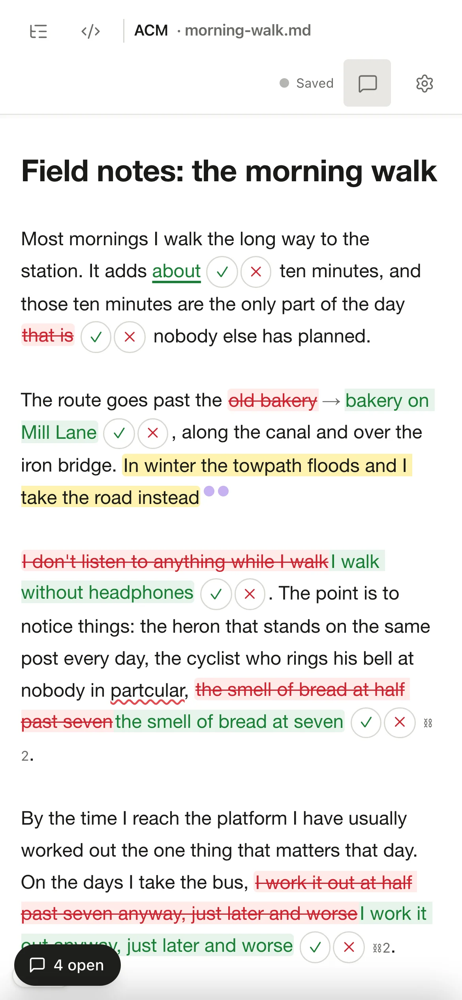

# Reviewing

This page is for the person deciding. Every comment and suggestion becomes a card beside the prose, and each decision you make is written straight back into the `.md` file.

## What you see

| In the page | Card in the margin | Your decisions |
| --- | --- | --- |
| Green underlined text with ✓ ✗ | **Add**: an inline suggestion to insert text | Accept, reject, edit, reply |
| Red struck text with ✓ ✗ | **Delete**: an inline suggestion to remove text | Accept, reject, reply |
| Struck old → green new | **Replace**: an inline substitution | Accept, reject, edit, reply |
| Struck span followed by green wording | **Suggested edit**: a SUGGEST card on an anchored span | Apply, Apply & resolve, Reject, edit, reply |
| Yellow highlight with dots | A comment thread on that span | Reply, Suggest edit, Mark seen, Resolve |
| A **Note** pill in the text | A point comment (no highlighted span) | Click it to open its card |
| Yellow highlight, no card | A plain highlight, a marking only | Edit the text |

- Replace and Suggested edit look alike in the page; the card label tells them apart. Both are suggestions, but only SUGGEST cards can join a suggestion group or be accepted from the shell.
- Each card shows its author (`@claude`, `@Sam`), coloured per author. Authors are self-declared labels, not accounts.
- A pill above the cards counts the comment threads you have not marked seen ("4 open"), and reads "all caught up" when there are none. Its ↑ and ↓ arrows step through the cards.
- A document with no cards uses no margin and stays centred; the comments button in the header shows or hides the margin by hand.
- The header shows the file name (hover for the full path), the word count, the save state, and **live** while the editor owns the file.

## Decide on a suggestion

- **Accept** applies the change and strips its markup from the file. **Reject** keeps the original text and strips the markup.
- Inline suggestions have ✓ and ✗ next to the text and on their card.
- A SUGGEST card has **Apply**, **Apply & resolve** and **Reject**. **Apply** puts the new wording in place and, by default, keeps any replies on the new text. **Apply & resolve** also removes the replies. With **Apply also resolves** turned on in Settings, Apply and Apply all remove the replies too.
- A suggestion whose anchor text no longer exists in the document still shows its suggested wording but offers no Apply.
- **Edit** (pencil) changes the proposed wording before you accept it, keeping the original author.

## Accept a group in one step

Suggestions that only make sense together (a moved clause, a spelling pass) carry a shared group tag. In the page, a ⛓2 after a suggestion marks a member of a two-card group. Each card in the group shows a chip such as **time · 2 edits**; open it to see every member, then **Apply all**, **Apply & resolve all** or **Reject all**. A large group opens in a scrollable side panel. The whole group lands as one change, so one undo reverts it.

Comments can share a group too (an agent writes them with `acm comment --group <id>`). The group then offers **Resolve all N notes** in one step.

## Comment, reply and resolve

- **Select text** to reveal **Add comment** and **Make suggestion** beside the selection, or press `Cmd+Option+M` / `Cmd+Option+S` (`Ctrl+Alt+M` / `Ctrl+Alt+S` on Windows and Linux). The comment box takes the cursor, so you can type straight away.
- **Reply** adds a comment to the thread. **Suggest edit** on a thread proposes new wording for its span.
- **Mark seen** records that you have read a thread. Agents see the same seen state in `acm threads`.
- **Resolve** removes the whole thread, comments and anchor markup, keeps the prose and moves to the next card. A resolved thread is gone from the file; [history](#undo-and-history) still has it.
- **Ask agent to edit** on a comment thread with a highlighted span replies "please suggest an edit" and marks the thread seen. An agent running `acm threads` sees it marked `[edit requested]` and answers with a SUGGEST card. A listening agent is woken at once.

## Send your comments to the agent

The pill in the header shows whether an agent is listening (a filled dot) and **Send N to agent**, the threads where you had the last word that the agent has not been sent yet. Press **Send** at the end of a review round to wake the agent once for all of them; a message confirms it, or says no agent is listening (the work then reaches the next agent that listens to this editor).

Click the status side of the pill, or open **Settings > Review**, for **Notify agent on each comment**. Off (the default), your comments wait for **Send**; on, every comment you post wakes the agent. An agent listens with `acm edit <file.md> --notify`; see [Agents](agents.md#waking-the-agent-from-the-editor).

## Move through the review by keyboard

| Keys | Action |
| --- | --- |
| `↓` / `↑` with a card selected | Next / previous card |
| `Alt+↓` or `Alt+J` | Next marked item (suggestion, highlight or comment) |
| `Alt+↑` or `Alt+K` | Previous marked item |
| `Alt+Y` | Accept the active inline suggestion |
| `Alt+N` | Reject the active inline suggestion |
| `Cmd+K` | Command palette |
| `Cmd+/` | Every shortcut |

The review keys work only when the focus is outside the text (click the card, or step to the suggestion with `Alt+J` / `Alt+K`), so typing `Alt` combinations in the editor never accepts anything. On Windows and Linux use `Ctrl` for `Cmd`.

## Edit the document

- The page renders Markdown as you type: headings, lists, links, tables, footnotes, images, and maths written as `$…$` or `$$…$$`.
- **Tables**: click a cell (or focus it and press `Enter`) to edit it in place; `Tab` moves between cells. Type `/table` on an empty line to insert one.
- **Lists**: deleting, moving or inserting an item renumbers the list.
- **Images**: drag an image onto the page or paste a screenshot. ACM saves it in an `assets/` folder beside the document and inserts the reference. Relative image paths may point anywhere in the document's git repository (or, outside a repository, its folder); `acm edit --asset-root <dir>` names another folder.
- **Toolbar**: the title bar holds undo, redo, the paragraph style (Normal text, Heading 1 to 3), bold, italic, link, bulleted and numbered lists, and Add comment / Suggest replacement. Each edits the Markdown, the same as the keyboard.
- **Page view** (on by default in Settings) shows the page's edges on a light grey background, marks where A4 page breaks fall and shows a page count.
- **Unsaved changes**: refreshing or closing the tab before an edit is saved asks first.
- **Raw Markdown**: the `</>` button in the header switches to the exact source with every marker visible.
- **Spelling**: misspellings get a wavy underline. Fix them, add them to your personal dictionary or ignore them.
- **HTML**: a safe subset renders (tables, lists, links, inline formatting). Scripts, styles, event handlers and custom elements are removed or left as source.
- **Who wrote what**: select text to see who wrote it, including the proposer and reviewer of an accepted suggestion. ACM keeps this in `.acm/provenance/` beside the document.

## Undo and history

- `Cmd+Z` undoes in the editor, including a group applied in one step.
- While ACM edits a document it records a history of versions. Every agent write through `acm` also takes a snapshot first. See `acm history` and `acm restore` in the [CLI reference](cli.md#acm-history).
- Every accept, reject and resolve is logged; `acm decisions` lists them.

## Narrow screens

On a phone the margin cards move into a bottom sheet behind the "4 open" pill, and the page uses the full width. Every decision stays available.

{ .phone }

## Print

`Cmd+P` prints the document with inline suggestions accepted and without markup or cards; SUGGEST cards print the original text. If broken markup would leak braces into the PDF, ACM asks you to fix it first; `acm heal` repairs most cases. Settings offers a **Simple** layout with endnotes and a **Tufte** layout with notes in the margin.
